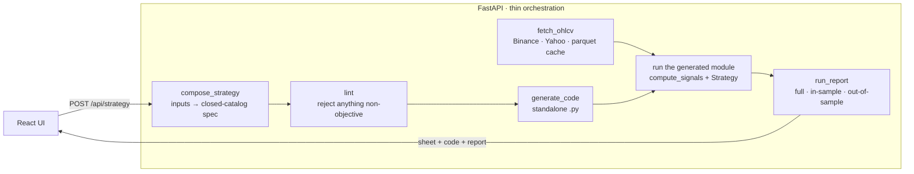
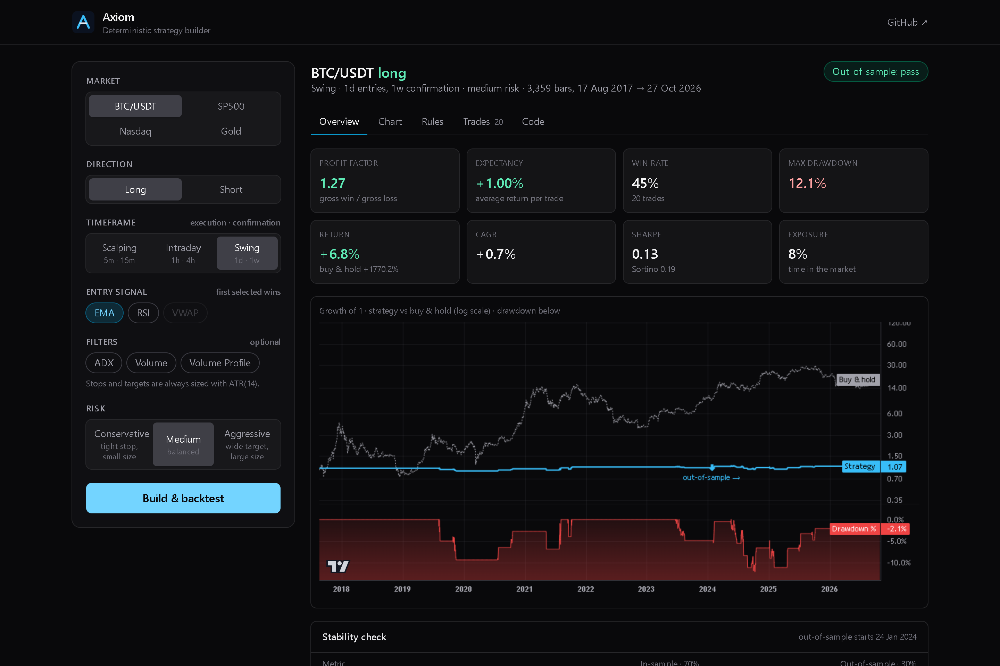
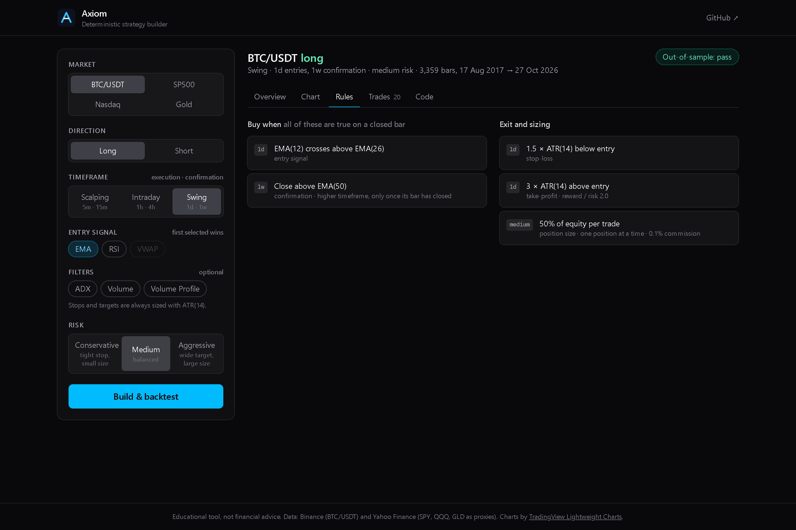
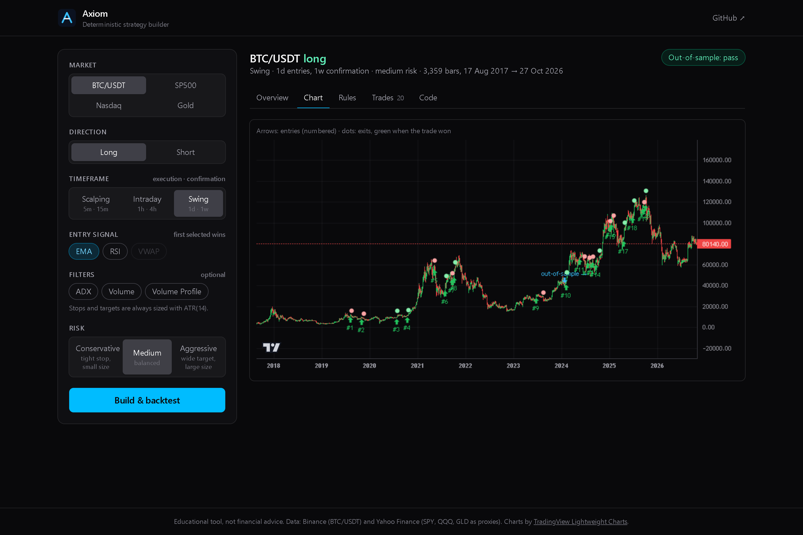
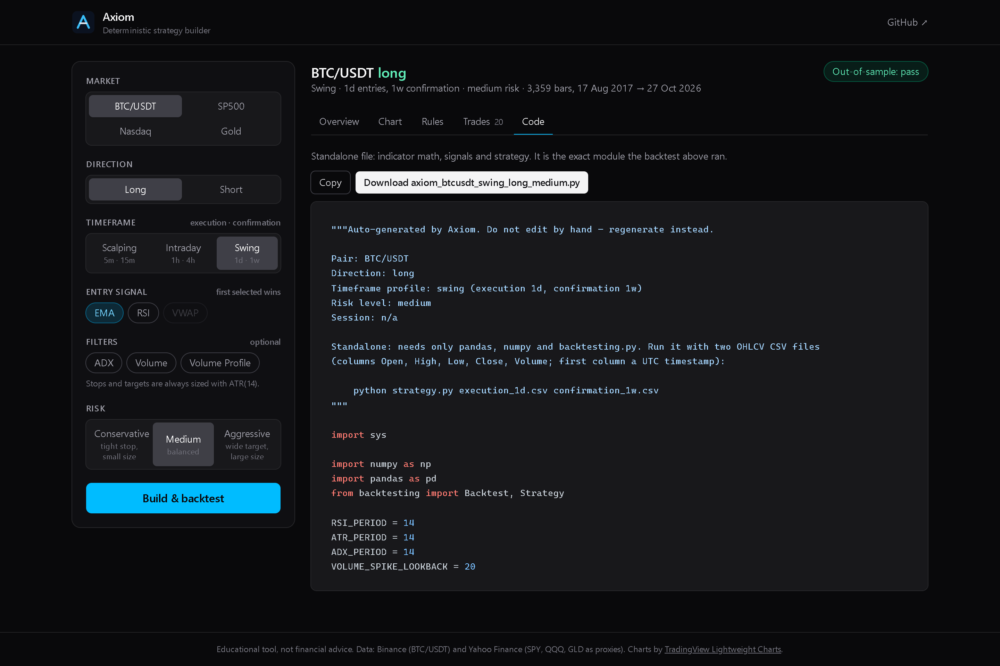

# Axiom

[](https://github.com/mateoullaa/axiom/actions/workflows/ci.yml)


[](LICENSE)

**Rules, not predictions.** Axiom builds fully mechanical trading strategies from a closed
catalog of rules, exports each one as a standalone Python file, and backtests that exact
file on real market data, with an out-of-sample check. There is no AI in the loop: the same
inputs always produce the same strategy, byte for byte.


## Why

Ask an LLM for a trading strategy and you get rules like "enter when momentum looks strong".
Nobody can automate or audit that, and the same prompt gives a different answer tomorrow.
Axiom takes the opposite bet and pushes every decision into deterministic code:

- **Closed catalog.** A strategy can only be built from objective primitives such as
  *EMA(12) crosses above EMA(26)*, *ADX(14) > 20*, *stop = entry − 1.5 × ATR(14)*.
  Anything else cannot even be constructed: the catalog is a set of Pydantic enums.
- **Linted before it exists.** A linter rejects any strategy with an undefined stop or
  target, a missing higher-timeframe confirmation, a rule on the wrong side, or an unbound
  threshold. The code generator re-lints before it renders a single line.
- **The file you download is the file that was tested.** The API backtests the generated
  module itself, and a test asserts it computes exactly the same signals as the reference
  implementation.
- **Honest results.** Every backtest is split 70/30 in time. A strategy only "passes" if its
  edge exists in-sample *and* survives the unseen 30%. Fewer than 5 out-of-sample trades
  is reported as inconclusive, not as a win.

## How it works



Each box is a single-purpose module in [`tools/`](tools/) with its own tests.

| Overview | Rules |
|---|---|
|  |  |
| **Chart** | **Code** |
|  |  |

## What it does today

| Input | Options |
|---|---|
| Market | BTC/USDT (Binance) · SP500, Nasdaq, Gold (SPY, QQQ, GLD via Yahoo Finance) |
| Direction | Long or short (directional rules are mirrored) |
| Timeframe | Scalping 5m/15m · Intraday 1h/4h · Swing 1d/1w (execution / confirmation) |
| Session (scalping) | Asia, London, NY AM, NY PM (UTC) |
| Entry signal | EMA cross, RSI out of oversold/overbought, VWAP cross |
| Filters | ADX trend strength, volume spike, volume-profile point of control |
| Risk | Stop/target in ATR multiples and position size (25%, 50% or 95% of equity) |

Output: a readable strategy sheet, a standalone Python file, and a report with profit
factor, expectancy, win rate, max drawdown, return vs buy & hold, CAGR, Sharpe, Sortino,
exposure, every trade, and the in-sample / out-of-sample comparison.

## Results

Reproducible with `python scripts/reproduce_results.py` (fixed window 2019-01-01 to
2026-07-01, UTC, 0.1% commission per side, 70/30 chronological split):

| Strategy | Trades | Win rate | Profit factor | Expectancy / trade | Max DD | Return | Buy & hold | IS PF | OOS PF (trades) | Out-of-sample |
|---|---:|---:|---:|---:|---:|---:|---:|---:|---:|---|
| BTC/USDT · swing · EMA · conservative · long | 20 | 65% | 1.99 | +1.7% | 3.3% | +7.2% | +1443.9% | 1.39 | 3.31 (10) | pass |
| BTC/USDT · swing · EMA · medium · long | 20 | 45% | 1.27 | +1.0% | 12.1% | +6.8% | +1443.9% | 1.40 | 1.12 (10) | pass |
| BTC/USDT · swing · EMA · aggressive · long | 18 | 44% | 1.90 | +4.7% | 27.5% | +78.6% | +1443.9% | 2.13 | 1.59 (8) | pass |
| BTC/USDT · swing · EMA · medium · short | 13 | 23% | 0.34 | -4.0% | 30.2% | -23.4% | +1443.9% | 0.15 | 2.36 (3) | inconclusive |
| SP500 · swing · EMA · medium · long | 18 | 44% | 1.12 | +0.2% | 5.0% | +1.2% | +198.5% | 1.31 | 0.85 (7) | fail |
| Gold · swing · EMA · medium · long | 24 | 46% | 1.96 | +0.7% | 2.9% | +8.4% | +203.6% | 1.84 | 2.26 (6) | pass |

How to read it:

- The swing EMA long strategy has a positive edge on BTC/USDT and Gold, and it holds out
  of sample.
- **It loses badly to buy & hold.** It is in the market a small fraction of the time and
  risks a fraction of equity per trade. The table is evidence that the rules engine
  produces testable strategies, not a claim that they beat the market.
- Samples are small (13–24 trades over 7.5 years), so read them as "viable", not as
  precise estimates of an edge. Shorting BTC lost money in-sample, and SP500's edge did
  not survive out of sample. Both are shown on purpose.

Earlier calibration runs, including the combinations that failed, are in
[`docs/calibration_notes.md`](docs/calibration_notes.md).

## Engineering highlights

- **No look-ahead.** Higher-timeframe signals are shifted forward one full bar before being
  merged, so a weekly value is only visible after that week has closed. A regression test
  covers it.
- **One mapping, two consumers.** `signal_spec()` maps each rule to the function that
  computes it. The backtest and the code generator both use it, and the generator copies
  the indicator source with `inspect`, resolving dependencies, so the math exists in one
  place.
- **Hand-rolled indicators.** RSI, ATR and ADX (Wilder smoothing), EMA, session-anchored
  VWAP and a rolling volume profile are written in plain pandas/numpy, auditable in
  [`tools/indicators.py`](tools/indicators.py).
- **Invalid combinations are rejected, not silently run.** VWAP on daily or weekly bars,
  ETFs in the Asia session, or a strategy with no entry signal return a specific message.
  Data outages return a JSON 502 instead of a crash.
- **Data layer.** Parquet cache with incremental refresh. Lookbacks respect Yahoo's
  intraday limits (60 days for 5m/15m, 730 for 1h), and a sidecar records the requested
  window so a short source history is never refetched in a loop.
- **93 tests**: unit tests per pipeline stage, the look-ahead regression, generated code
  vs reference equivalence, the generated file run as a subprocess in isolated mode, and
  API error paths. 3 of them hit live data and are opt-in (`pytest -m integration`).

## Getting started

```bash
# Backend (Python 3.12+)
python -m venv .venv && source .venv/bin/activate      # .venv\Scripts\activate on Windows
pip install -r requirements-dev.txt
pytest                                                 # 90 offline tests
uvicorn backend.main:app --port 8000

# Frontend (Node 20.19+)
cd frontend && npm install && npm run dev              # http://localhost:5173, proxies /api
```

Run an exported strategy on your own data:

```bash
python axiom_btcusdt_swing_long_medium.py btc_1d.csv btc_1w.csv
```

## Tech stack

Python · FastAPI · Pydantic v2 · pandas/numpy · [backtesting.py](https://kernc.github.io/backtesting.py/) ·
React 19 · Vite · Tailwind CSS · [TradingView Lightweight Charts™](https://www.tradingview.com/lightweight-charts/) ·
pytest · ruff · GitHub Actions

## How it was built

Axiom was built with a structured, AI-assisted workflow in
[Claude Code](https://claude.com/claude-code): one agent working through sequential
**planner → builder → reviewer** roles, where the reviewer blocks progress on any failed
check and records the lesson. I wrote the spec, made the design calls and validated the
results against real data. Unlike the product, the development process used an LLM.
The product itself has none at runtime.

- [`docs/development/workflows/`](docs/development/workflows/): the spec each tool implements
- [`docs/development/memory.md`](docs/development/memory.md): bugs found and lessons learned
- [`docs/development/roles/`](docs/development/roles/): the role definitions

## Limitations

- One position at a time, one entry signal per strategy (first selected of EMA › VWAP › RSI).
- Equity indices and gold are traded through ETF proxies, with raw (unadjusted) prices.
- Intraday history is short (about 60 days of 5m bars), so scalping results rarely have
  enough trades to be meaningful. The out-of-sample verdict says so.
- `api.binance.com` is geo-blocked in some regions, including the US.

## License

[MIT](LICENSE) © 2026 Mateo Ulla. Educational project, not financial advice: a backtest,
however careful, does not predict future performance.
